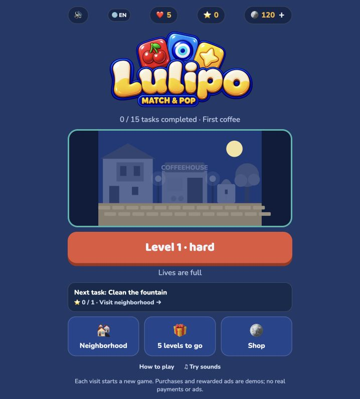

# Lulipo: Match & Pop — Android testing

Lulipo is a colorful match-3 puzzle game featuring short rounds, combos and progressively introduced ice and lock obstacles. Turkish and English are supported.

## Join the test

Download **Lulipo-Android-Test.apk** from [Releases](https://github.com/ybalci/lulipo-testing/releases/tag/v0.2.0-test). Do not download APKs posted by other accounts.

**Current build:** 0.2.0-test (2) · Android 7.0 or later · about 6.6 MB.

A Google Play closed-test link is **not available yet**. Installing the GitHub APK does not enroll you in Google Play’s closed test or count toward its tester requirement.

## Install

1. Download the APK on your Android phone.
2. Open the download and, if Android asks, allow installation from that browser or file manager.
3. Install **Lulipo · Test**. You may turn that installation permission off afterwards.
4. Launch the game and choose Turkish or English using the language button.

This APK is signed with a development test key, not the final store signing key. An existing compatible test installation can be updated. Back up anything important before removing any app.

## What to expect

- 20 moves per level and 10 seconds per move; a timeout costs one move.
- New sessions start at level 1 in this prototype.
- Rewarded ads and purchases are explicitly **demos**; no real advertising or payment occurs.
- No login or account is required by the game. Gameplay and media are bundled for offline use.
- This is a work in progress, not a Google Play production release.

## Feedback

Please use **Issues → New issue** for bugs or gameplay feedback. Include your phone model, Android version, game version, steps to reproduce, and screenshots where useful. Avoid posting personal data, email addresses or credentials in public issues.

Focus on touch accuracy, tile visibility, difficulty, timers, combos, ice/locks, sound, and leaving/returning to the app. See [the test guide](TESTING.md).

## Repository scope

This repository contains tester documentation, promotional images and download releases. The game’s source code and licensed raw sound assets are not distributed here. No open-source license is granted for the game or its media.
